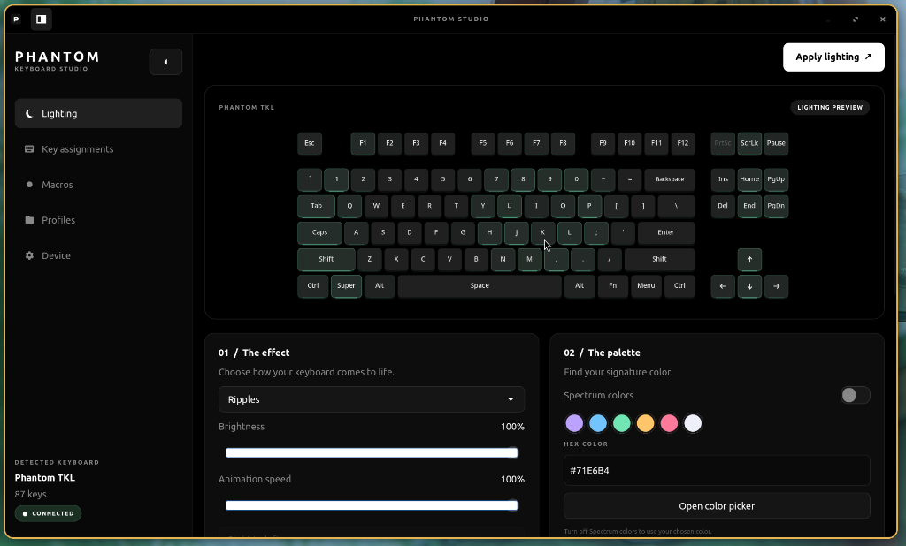
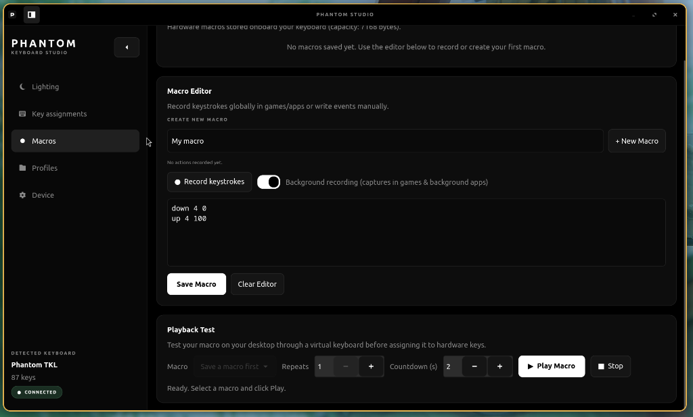
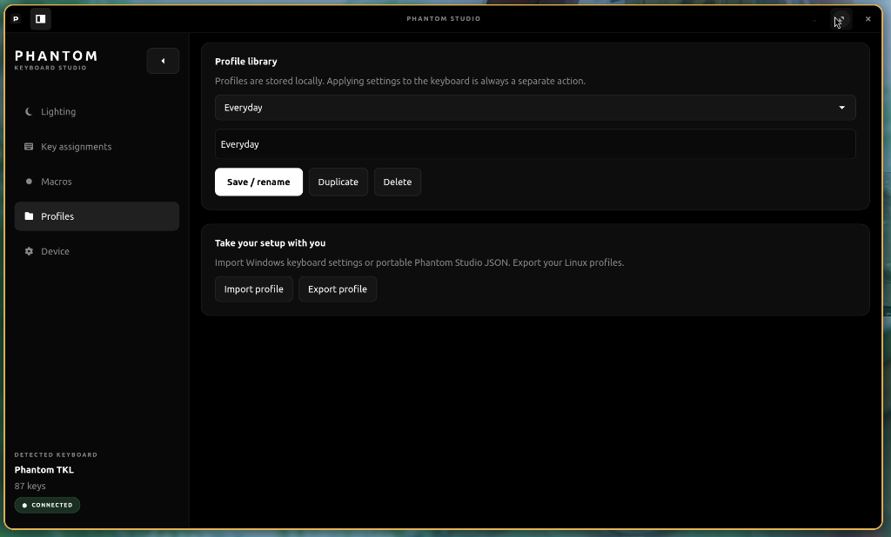

# Phantom Studio

**A reverse engineering project by nirusaki.** A native Rust and GTK4 control app for the **Cosmic Byte Phantom TKL Casket keyboard** (`320f:505b`).

## Screenshots

<p align="center">
  
  
  
</p>

## Supported Platforms

- **Linux (Wayland and X11)**: Native GTK4 desktop application with collapsible sidebar, real-time lighting previews, background macro recording, high refresh rate compositor synchronization, and compact tiling support. Release packages for `x86_64` and `aarch64` / ARM64.
- **macOS**: GTK4 desktop builds for Apple Silicon (`aarch64-apple-darwin`) and Intel (`x86_64-apple-darwin`).

## Install on Linux

Open a terminal and paste this **without sudo**:

```sh
curl -fsSL https://raw.githubusercontent.com/Nirusaki-Malaal/phantom-tkl-driver/main/bootstrap.sh | sh
```

The universal source installer detects Linux or macOS and x86_64 or ARM64, downloads the source and builds for your machine. On Linux it installs your application-menu shortcut and keyboard/macro playback rules. It asks for your password when system setup needs it. Open **Phantom Studio** from your application menu when it finishes.

## Install on macOS (experimental)

Install [Homebrew](https://brew.sh) first, then run the same command above. The installer builds with GTK4 and installs `~/.local/bin/phantom-studio`; launch that command from a terminal. Background recording and desktop macro playback require Linux.

GTK **4.12 or newer** is required. Linux dependency setup supports apt, pacman, dnf and zypper. To accept dependency installation automatically, use `curl -fsSL URL | sh -s -- --yes` with the URL above. To inspect the plan, pass `--dry-run` instead.

Pre-built desktop bundles are available in [Releases](https://github.com/Nirusaki-Malaal/phantom-tkl-driver/releases). [Binary/source installation, installer options and uninstalling](docs/DOCUMENTATION.md#installation).

## Features

- **RGB Lighting**: 19 effects, per-key custom colors and live animation previews synchronized to the display frame clock (supporting 60Hz, 120Hz, 144Hz, 165Hz, and beyond).
- **Key Assignments**: Keyboard, media and supported mouse actions, with named macro selection and onboard configuration.
- **Macros**: A saved macro library, individual editing/deletion, unique names, background recording on Linux and cancellable desktop playback.
- **Profiles**: Save, copy, rename, import and export lighting, assignments and macros.
- **Device Controls**: Windows/Super-key lock and unlock, WASD/arrow swap, rollover and 1000Hz USB polling-rate settings.
- **Desktop UI**: Minimal dark slate, a collapsible sidebar, and clean, responsive layouts.

## AI usage disclosure

Reverse engineering and development were AI-assisted using **GPT-6.1 Sol (medium effort)** and **Gemini Flash 3.8 (high effort)**. Code, protocol behavior and platform support still require tests and hardware verification; see the [validation boundaries](docs/DOCUMENTATION.md#validation-boundaries).

## License

[GPL-3.0-or-later](LICENSE). Phantom Studio is independent of the keyboard vendor. Read the [documentation](docs/DOCUMENTATION.md) and [release notes](docs/RELEASE_NOTES.md) for setup, current limits and development details.
